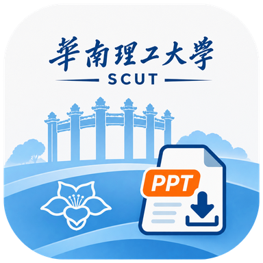

# 华工课栈 · SCUT Slides

**给华南理工大学同学用的课堂 PPT 获取与阅读工具。**

**上过的课，回来找 PPT。** 登录学校账号，按课表找到课程，获取课堂 PPT 页面；下载后离线复习，也能导出 PDF、分享给同学。上课时还可以跟看老师新增的页面。

<p>
  
  
  
</p>

**[⬇ 下载 Android 安装包](https://github.com/goooseby/keye-android/releases/latest/download/keye-android.apk)** · [查看更新](https://github.com/goooseby/keye-android/releases) · [反馈问题](https://github.com/goooseby/keye-android/issues)

获取范围以本人学校账号可访问、且学校课堂视频平台已记录的课件为准。这里的 PPT 指课堂投影片内容，保存为页面图片并可导出 PDF，不提供原始 PPT／PPTX 文件。

---

## ✨ 它能帮你做什么

| 场景 | 华工课栈怎么帮你 |
| --- | --- |
| 📅 **上过的课，找回 PPT** | 从课表点进对应课次，直接阅读或获取课件；也能按课程查找。 |
| 📥 **复习前，一次备齐** | 按今天、近两周、本学期或自选日期查询，批量选择、下载课件。 |
| 📖 **通勤、宿舍，离线接着看** | 课件保存在本机，自动记住上次读到的页面与位置；不用反复翻找。 |
| 🖥️ **上课跟看，也能往回翻** | 持续获取老师新增的页面；手动回看时不强制跳走，随时回到最新页。 |
| 🔖 **重点留住，复习省事** | 页面书签、按页文字批注、缩放、跳页、页面总览与横屏全屏阅读。 |
| 📤 **整理完，导出带走** | 保存单页图片，按全部、当前页或指定范围导出 PDF，通过系统分享。 |

也支持导入本地 PDF 和图片。已有的本地课件，无需学校登录即可阅读、整理和导出。

## 🚀 三步开始

1. **安装应用**：下载并安装 APK，支持 Android 8.0 及以上。
2. **登录学校账号**：连接华南理工大学课堂视频平台，查看可访问的课程与课件。
3. **找到课程并打开**：从课表进入对应课次，或在“获取课件”中按日期批量下载。

**找到课 → 获取 PPT 页面 → 离线阅读 / 导出 PDF**

已下载内容会保存在本机，退出学校账号不会删除课件。再次打开时自动续读；卸载前请先导出需要保留的资料。

## 🧰 阅读与管理

- **两种阅读方式**：默认竖屏连续滚动，也可切换逐页；支持双击和双指缩放。主动进入全屏时自动横屏。
- **课堂页面自动保留**：跟看时新增页保存到对应课程，中途退出后可检查并补全缺页，已有书签和批注保留。
- **页面整理**：单页或批量移除、撤销及恢复；原件保留，阅读与默认导出跳过已移除页。
- **课程管理**：课程归类、名称与备注、课件搜索、下载参数、保存目录及回收站。
- **应用内更新**：检查 GitHub Releases，通过系统下载并安装更新；支持忽略某个版本和关闭自动提醒。

Android 10 起，PDF 默认导出到“下载 / Keye”，单页图片默认保存到“图片 / Keye”；也可在支持的入口选择其他目录。Android 8–9 首次导出需选择保存位置。同名文件自动编号。

## 📌 使用说明

- 学校课件依赖学校平台提供的内容与实际可用性；平台没有记录的页面无法凭空补出。
- 课堂跟看同步的是课件页面，不包含音视频；不支持幻灯片动画或原生 PPTX 解析。
- 下载和导出随应用进程运行，目前不提供持久后台恢复；课堂跟看在离开界面或切到后台时暂停。
- 文字批注是按页保存的文字记录；当前没有笔迹批注、OCR、全文搜索或云同步。

## 📚 项目文档

[产品与交互设计](docs/PRODUCT_DESIGN.md) · [课表与直接阅读](docs/TIMETABLE.md) · [课堂跟看](docs/CLASSROOM.md) · [界面规范](docs/UI.md)

[实现与能力边界](docs/IMPLEMENTATION.md) · [开发环境与调试](docs/ENVIRONMENT.md) · [更新与发布](docs/UPDATES.md)

---

<details>
<summary><strong>🛠️ 开发与构建</strong></summary>

原生 Android 应用，使用 Kotlin 与 Jetpack Compose。当前项目版本为 **0.3.1**。

| 项目 | 配置 |
| --- | --- |
| 中文名称 / 英文名称 | 华工课栈 / SCUT Slides |
| 包名 | `io.github.goooseby.keye`，沿用原包名以保持更新兼容 |
| 最低系统 | Android 8.0（API 26） |
| 构建环境 | JDK 21、Android SDK Platform 36、Android Studio |
| 构建工具 | Gradle Wrapper 8.13、Android Gradle Plugin 8.13.2、Kotlin 2.2.21 |
| 字节码目标 | Java 17 |

1. 克隆仓库，用 Android Studio 打开项目根目录。
2. 安装 SDK Platform 36 和对应构建工具，将 Gradle JDK 设为 JDK 21。
3. 由 Android Studio 生成本机 `local.properties`，或设置 `ANDROID_HOME`。
4. 使用仓库自带的 Gradle Wrapper 构建，无需另外安装 Gradle。

```powershell
# Windows PowerShell
.\gradlew.bat :app:assembleDebug :app:testDebugUnitTest :app:lintDebug
```

```sh
# macOS / Linux
./gradlew :app:assembleDebug :app:testDebugUnitTest :app:lintDebug
```

Debug APK：`app/build/outputs/apk/debug/app-debug.apk`。检查报告：`app/build/reports/`。

开发者自备 SDK 和设备；仓库不包含学校登录凭据、课件内容、签名密钥或构建产物。

### 源码结构

```text
app/src/main/java/io/github/goooseby/keye/
├── MainActivity.kt       应用入口与导航
├── KeyeViewModel.kt      应用状态与任务调度
├── data/                 资料库、阅读记录与媒体处理
├── network/              学校接口与登录状态
├── domain/               课表、页面与课堂规则
├── ui/                   课表、课程、获取、设置及阅读器
├── export/               导出与保存
└── update/               检查更新、下载与安装
```

`app/src/debug/` 为仅用于 Debug 的观察入口；`app/src/test/` 为领域规则测试。保持单个 Android 模块，按稳定职责分组。Release 开启 R8 优化、混淆和资源压缩。

包名、仓库地址、下载文件名与已有 `Keye` 保存目录继续沿用，避免影响旧版本更新与已有文件的定位。正式发布使用原签名并递增 `versionCode`，详见[更新与发布](docs/UPDATES.md)。

</details>
